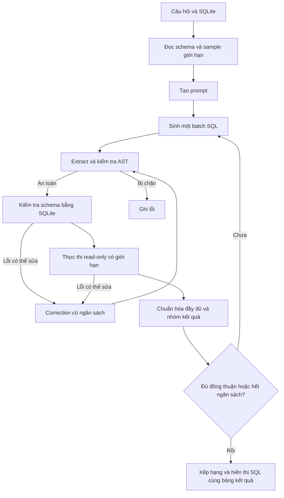
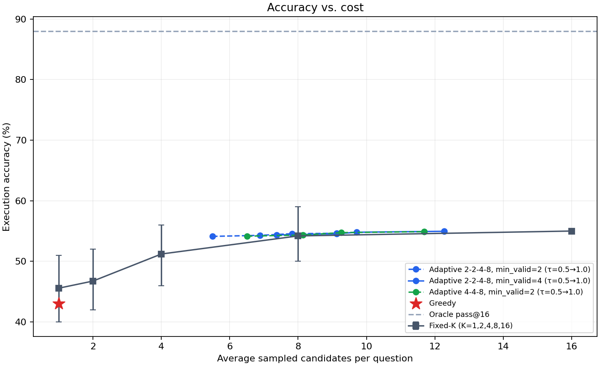
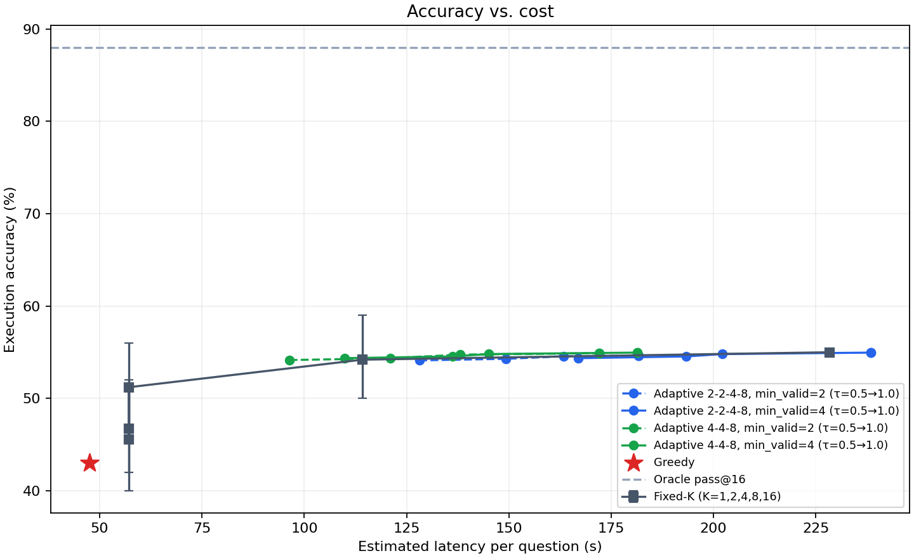

# Adaptive SLM SQL

**Mới clone repo?** Xem [SETUP.md — cài đặt, tải model và chạy từ đầu](SETUP.md).

**Đánh giá schema pruning với mô hình gốc:** xem [hướng dẫn A–Z: full vs pruning, metric và biểu đồ](docs/EVALUATION_A_TO_Z.md), hoặc chạy [notebook Kaggle](notebooks/kaggle_schema_pruning_bird.ipynb). Có script so sánh theo từng câu, CI, latency/token/VRAM và biểu đồ retrieval từ Mini-Dev thực đo.

Ứng dụng local chuyển câu hỏi tiếng Việt/tiếng Anh thành SQL trên SQLite. Pipeline đọc schema, sinh SQL, kiểm tra, thực thi và chọn ứng viên dựa trên kết quả. Có giao diện Streamlit và CLI thực nghiệm.

**Chạy nhanh trên máy hiện tại:** mở `scripts/run_demo.bat`. Môi trường `.venv` đã được tạo trong project. Mặc định dùng **huggingface**, model **SLM-SQL-1.5B**, thiết bị **auto** (ưu tiên GPU) và phương pháp **greedy**. Nhập câu hỏi tiếng Việt/tiếng Anh → **Generate SQL**, hoặc chọn câu hỏi mẫu → **Dùng câu hỏi mẫu** → **Generate SQL**. Lần đầu bấm sẽ tải model vào bộ nhớ; các câu sau dùng lại model. Có thể chuyển sang `adaptive_sc` để thử nhiều ứng viên, thời gian chạy sẽ tăng.

Weights mặc định được lưu trong `models/SLM-SQL-1.5B` bên trong project, dùng chung cho script tải và UI/CLI. Cấu hình `local_files_only: true` dùng model đã tải, không cần mạng khi demo. Backend `huggingface` tự sinh SQL từ câu hỏi và schema, không tra đáp án fixture. Chất lượng câu trả lời cần kiểm tra; SQL thực thi thành công chưa chắc đúng ý nghĩa. Backend `mock` vẫn có thể chọn riêng để kiểm thử giao diện.

## 1. Phạm vi và cơ sở nghiên cứu

Project triển khai inference bằng model đã huấn luyện, không huấn luyện SFT/GRPO. Phương pháp thử nghiệm là lấy mẫu theo vòng `[4, 4, 8, 16]`, dừng khi có đủ ứng viên hợp lệ và đồng thuận, kết hợp kiểm tra schema và sửa SQL lỗi. Mục tiêu thực nghiệm là đo khả năng giảm số lần sinh và độ trễ so với lấy mẫu cố định, đồng thời theo dõi độ chính xác.

Tham khảo [bài báo SLM-SQL, Findings IJCNLP-AACL 2025](https://aclanthology.org/2025.findings-ijcnlp.92.pdf), [repository tác giả](https://github.com/CycloneBoy/slm_sql) và [model card 0.5B](https://huggingface.co/cycloneboy/SLM-SQL-0.5B). Đã kiểm tra ngày 10/09/2026: repository chưa cung cấp pipeline inference hoàn chỉnh; model card cho biết model thuộc họ Qwen2.5-Coder. Tokenizer config dùng `Qwen2Tokenizer`, chat template ChatML, hỗ trợ `add_generation_prompt`.

Prompt trong `core/prompt_builder.py` là bản tự viết dựa trên cấu trúc Phụ lục E.1: engine, schema, evidence và question. Đầu ra yêu cầu `<answer>...</answer>`. Khác với prompt nghiên cứu, ứng dụng yêu cầu SQL duy nhất và không yêu cầu xuất quá trình suy luận. Nếu model vẫn trả `<think>`, parser bỏ phần đó; UI/trace không xuất raw output. Vì khác prompt và chế độ inference, không xem project là bản tái hiện điểm số bài báo.

Correction là sửa một SQL lỗi bằng generation model, khác bước CSC so sánh hai nhóm ứng viên của bài báo. Interface cho phép truyền `correction_backend` riêng vào `Pipeline`; bản CLI/UI dùng generation model. Không tích hợp bước merge CSC trong bản demo này.

## 2. Pipeline



## 3. Tính năng

- Greedy một ứng viên; fixed SC với K; adaptive SC theo các vòng.
- SQLite mẫu hoặc upload `.db`/`.sqlite` tối đa 20 MB.
- Schema có cột, kiểu, PK, FK và mẫu giá trị. Tên bảng/cột ASCII, dữ liệu và câu hỏi tiếng Việt.
- SQLGlot parse AST; chặn ghi, multi-statement, bảng hệ thống, database ngoài, hàm ngoài allowlist.
- SQLite `mode=ro`, `query_only`, `trusted_schema=OFF` và authorizer độc lập ở executor.
- SQLite prepare kiểm tra bảng/cột/alias/CTE/subquery; JOIN có cảnh báo về tính đúng nghiệp vụ.
- Timeout, progress handler, giới hạn kích thước và số dòng kết quả.
- Bảng SQL ứng viên, phiếu, điểm, lỗi, sửa lỗi; trace từng vòng; xuất JSON/CSV.
- CLI đánh giá, ablation sáu cấu hình và ba biểu đồ PNG.
- Mock không tải model; unit tests và Streamlit AppTest không cần model thật.

## 4. Cấu trúc

```text
adaptive-slm-sql/
  app.py
  README.md
  config.yaml
  requirements.txt
  requirements-model.txt
  requirements-gpu.txt
  pyproject.toml
  Dockerfile
  .env.example
  .streamlit/config.toml
  core/
    config.py                 types.py
    model_backend.py          hf_model.py              mock_model.py
    schema_inspector.py       schema_selector.py       prompt_builder.py
    sql_extractor.py          sql_generator.py         sql_validator.py
    sql_executor.py           result_normalizer.py     result_grouper.py
    candidate_ranker.py       adaptive_sampler.py      sql_corrector.py
    pipeline.py
  databases/
    create_student_db.py      student_management.db
  data/
    demo_questions.json       evaluation_questions.json
  evaluation/
    metrics.py                evaluate.py
    run_ablation.py           plot_results.py
    run_sweep.py              plot_sweep.py
    sweep_report.py
  docs/results/               biểu đồ và sweep.csv của mục Số liệu kết quả
  scripts/
    download_model.py         smoke_test.py
    run_demo.bat              import_bird.py
  tests/
    conftest.py               test_schema_inspector.py
    test_sql_extractor.py     test_sql_validator.py    test_sql_executor.py
    test_result_grouper.py    test_adaptive_sampler.py test_pipeline_mock.py
    test_app.py
  results/
```

## 5. Phần cứng và Python

Python **3.11 hoặc 3.12**. Đã dùng Python 3.12 của máy để kiểm thử. Không chọn Python 3.10 vì executor dùng API `sqlite3.Connection.setlimit` từ Python 3.11.

Mock chỉ cần CPU; nên có 4 GB RAM. Model 0.5B trên CPU FP32 cần khoảng vài GB cho weights và runtime; nên có 8 GB RAM trở lên và vài GB đĩa trống cho cache. GPU 4 GB có thể thử batch 1–2, prompt ngắn, FP16; đây là cấu hình khởi đầu, không bảo đảm mọi truy vấn vừa bộ nhớ. Model 1.5B cần nhiều bộ nhớ hơn. CPU có thể chậm khi sinh nhiều ứng viên.

## 6. Setup Windows PowerShell từ đầu

Cài Python 3.11 từ [python.org](https://www.python.org/downloads/), bật tùy chọn thêm Python vào PATH. Mở PowerShell mới, chuyển vào thư mục project. Trên workspace hiện tại:

```powershell
cd 'C:\Users\Laptop\Desktop\HOC TAP CUC MANH\httm\SLM-PRJ\adaptive-slm-sql'
py -3.11 -m venv .venv
.\.venv\Scripts\Activate.ps1
python -m pip install -r requirements.txt
python databases/create_student_db.py
python -m pytest -q
python scripts/smoke_test.py --backend mock
python -m streamlit run app.py
```

Nếu đã có `.venv` trong project, bỏ qua lệnh tạo venv. Nếu chỉ cài Python 3.12, thay `py -3.11` bằng `py -3.12`. Nếu PowerShell chặn activate, không cần đổi policy: dùng đường dẫn Python trực tiếp:

```powershell
.\.venv\Scripts\python.exe -m pip install -r requirements.txt
.\.venv\Scripts\python.exe databases/create_student_db.py
.\.venv\Scripts\python.exe scripts/smoke_test.py --backend mock
.\.venv\Scripts\python.exe -m streamlit run app.py
```

Mở `http://127.0.0.1:8501` trong trình duyệt. Có thể chạy `scripts\run_demo.bat`; script dùng Python trong venv, tạo DB nếu thiếu và mở server local. Database đã có sẽ được giữ nguyên, không bị reset dữ liệu.

### Model thật trên CPU

Trong venv đã activate:

```powershell
python -m pip install torch==2.6.0 --index-url https://download.pytorch.org/whl/cpu
python -m pip install -r requirements-model.txt
$env:HF_HOME = "$PWD\.cache\huggingface"
python scripts/download_model.py
python scripts/smoke_test.py --backend huggingface --device cpu --mode greedy
python -m streamlit run app.py
```

Trên UI chọn backend `huggingface`, device `cpu`, phương pháp `greedy` để thử trước. `requirements.txt` cố ý không kéo PyTorch, để mock nhẹ. `.env.example` chỉ là ví dụ; chương trình không tự đọc file `.env`. `HF_HOME` cần được đặt trong shell như trên.

### Model thật trên NVIDIA CUDA

[Trang cài các phiên bản PyTorch](https://pytorch.org/get-started/previous-versions/) cung cấp wheel CPU và CUDA. Ví dụ cho CUDA 11.8, cần driver tương thích:

```powershell
python -m pip install --force-reinstall torch==2.6.0 --index-url https://download.pytorch.org/whl/cu118
python -m pip install -r requirements-model.txt
python -c "import torch; print(torch.__version__); print(torch.cuda.is_available())"
python scripts/smoke_test.py --backend huggingface --device cuda --mode greedy
```

Không cần cài torchvision/torchaudio cho project. Dòng “CUDA Version” trong `nvidia-smi` không đồng nghĩa đã cài PyTorch CUDA. Project không tự thay driver.

Quantization tùy chọn:

```powershell
python -m pip install -r requirements-gpu.txt
```

Chọn `4bit` hoặc `8bit` trong UI. CPU tắt quantization và dùng FP32. Nếu backend bitsandbytes không khả dụng/tương thích, chương trình báo cảnh báo và thử dtype thường. Nếu hết VRAM, giảm batch hoặc chuyển CPU.

### Đổi model 1.5B

Đổi Model ID thành `cycloneboy/SLM-SQL-1.5B` trong UI hoặc `config.yaml`:

```powershell
python scripts/download_model.py --model-id cycloneboy/SLM-SQL-1.5B
python -m evaluation.evaluate --backend huggingface --model-id cycloneboy/SLM-SQL-1.5B --mode greedy --limit 1
```

## 7. Linux/macOS và notebook

```bash
cd adaptive-slm-sql
python3.11 -m venv .venv
source .venv/bin/activate
python -m pip install -r requirements.txt
python databases/create_student_db.py
python -m pytest -q
python scripts/smoke_test.py --backend mock
python -m streamlit run app.py
```

Linux CPU: dùng wheel CPU như Windows. macOS: `python -m pip install torch==2.6.0` rồi cài `requirements-model.txt`; bản demo chạy CPU, chưa có backend MPS.

Colab/Kaggle: đưa thư mục source lên notebook, chuyển working directory vào project, cài hai file requirements, dùng PyTorch GPU có sẵn nếu tương thích. Chạy CLI evaluation trực tiếp, không cần tunnel UI. Không tải database cá nhân lên môi trường cloud nếu bạn muốn dữ liệu chỉ nằm trên máy local. Chưa kiểm chứng Colab/Kaggle trong phiên triển khai này.

## 8. Dữ liệu: tự tạo gì, tải gì?

`create_student_db.py` tạo dữ liệu hoàn toàn giả định: 4 khoa, 6 lớp, 16 sinh viên, 8 môn và các lượt đăng ký. Có lớp/khoa rỗng, môn chưa đăng ký, sinh viên chưa đăng ký, điểm NULL, điểm bằng nhau và điểm dưới 5 để kiểm tra trường hợp biên.

- `demo_questions.json`: 100 câu cho UI, cũng là fixture mà mock biết đáp án.
- `evaluation_questions.json`: 100 câu khác, giữ riêng cho model thật. Không được đưa gold SQL vào prompt.
- Mỗi item có `id`, `question`, `gold_sql`, `difficulty`, `tags`, `language`, `source`, `db_id`.
- Script tạo DB kiểm tra 200 gold SQL chạy được. Đáp án được viết theo nghĩa câu hỏi nhưng chưa được một người gán nhãn độc lập kiểm định.
- Không có dataset huấn luyện: model đã được huấn luyện sẵn. Tạo/tải dataset đánh giá không tự nâng năng lực model.

**Mock trên 100 câu đánh giá có EX = 0 theo thiết kế**, do không hỗ trợ câu ngoài fixture. Đây là kiểm tra luồng lỗi và xuất báo cáo. EX cao trên 100 câu demo chỉ là kiểm tra phần mềm, không phải kết quả nghiên cứu.

### Dùng BIRD bên ngoài

Nên bắt đầu với [BIRD Mini-Dev chính thức](https://github.com/bird-bench/mini_dev), tải gói SQLite có cả câu hỏi và database. Sau đó có thể dùng [BIRD development](https://bird-bench.github.io/). Không dùng file dự đoán của tác giả làm gold SQL, không chỉ tải JSON mà thiếu DB.

Giả sử gói đã tải có `mini_dev_sqlite.json` và cấu trúc `dev_databases/<db_id>/<db_id>.sqlite`:

```powershell
python scripts/import_bird.py --questions data/benchmarks/mini_dev_sqlite.json --database-root data/benchmarks/dev_databases --output data/benchmarks/bird_eval.json
python -m evaluation.evaluate --backend huggingface --mode greedy --dataset data/benchmarks/bird_eval.json --limit 10
python -m evaluation.run_ablation --backend huggingface --dataset data/benchmarks/bird_eval.json --limit 10
```

Thay đường dẫn theo gói thực tế. Importer nhận `SQL` hoặc `sql`, giữ evidence, kiểm tra đường dẫn DB và ghi `db_path` tương đối với JSON đầu ra. Không tự tải hay thay đổi database. Pipeline cũng nhận dataset JSON tự viết theo định dạng này. BIRD chưa được tải/chạy trong phiên triển khai.

Tách tập chỉnh ngưỡng và tập đánh giá cuối; báo cáo rõ subset, ngôn ngữ, seed, model, prompt, giới hạn thời gian/kết quả và số câu bị lỗi. Nếu dịch câu hỏi tiếng Anh sang tiếng Việt, kiểm tra bản dịch và báo cáo thành một tập riêng.

## 9. Evaluation và ablation

```powershell
python -m evaluation.evaluate --backend mock --mode adaptive_sc --dataset data/evaluation_questions.json --output results/mock-heldout
python -m evaluation.evaluate --backend mock --mode adaptive_sc --dataset data/demo_questions.json --output results/mock-demo
python -m evaluation.run_ablation --backend mock --dataset data/demo_questions.json --output results/mock-ablation
python -m evaluation.plot_results results/mock-ablation/ablation.csv
```

Đánh giá thật:

```powershell
python -m evaluation.evaluate --backend huggingface --mode greedy --dataset data/evaluation_questions.json --limit 5 --output results/real-greedy
python -m evaluation.run_ablation --backend huggingface --dataset data/evaluation_questions.json --output results/real-ablation
```

Mỗi lần evaluation ghi `predictions.jsonl`, `summary.csv`, `summary.json`, `config.json`. Summary có hash dataset và seed. `--output` chỉ đến thư mục kết quả cùng tên sẽ ghi lại các báo cáo trong đó; bỏ tham số để dùng timestamp.

Sáu ablation: greedy, fixed SC@8, fixed SC@16, adaptive, adaptive+validation, adaptive+validation+correction. Safety luôn bật. Schema validation off chỉ bỏ bước prepare trước khi chạy; SQLite vẫn kiểm tra tên lúc thực thi. Vì vậy riêng validation có thể không tăng EX, nhưng giúp phát hiện/phân loại lỗi sớm. Không tuyên bố improvement nếu số liệu không hỗ trợ.

| Metric | Định nghĩa |
|---|---|
| EX | Số câu predicted result bằng gold result / tổng số câu |
| VSR | Số ứng viên cuối chạy được / tổng số ứng viên gốc; ứng viên đã sửa thay thế bản lỗi |
| Exact match | AST SQL chuẩn hóa giống nhau; metric phụ |
| Average candidates | Số ứng viên gốc trung bình, chưa cộng correction |
| Average total generations | Ứng viên gốc cộng số lần correction, proxy chi phí |
| Latency | Toàn pipeline gồm schema, sinh, kiểm tra, sửa; không gồm load model |
| P50/P95 | Phân vị latency nội suy tuyến tính |
| Correction success | Lần sửa chạy được / số lần sửa; không khẳng định đúng gold |
| Early-stop | Dừng do consensus trước hết ngân sách ứng viên / tổng số câu |
| Error breakdown | Mỗi câu sai nhận một loại lỗi cuối; wrong_result nếu có SQL chạy được |

Khi không có mẫu, các rate trả 0. Model load được đo riêng. Cần warm-up và nhiều seed khi làm báo cáo nghiêm túc; script hiện chạy một seed cấu hình. Fixed/greedy có thể đạt đủ ứng viên trước adaptive nên không tính là early-stop.

Chuẩn hóa bảo toàn dòng trùng, số cột, kiểu NULL/text/bytes. Số nguyên 1 và số thực 1.0 được coi bằng nhau; số thực khác biệt vẫn khác, không dùng tolerance rộng. EX theo thứ tự gold nếu gold có ORDER BY/LIMIT; nếu không thì so multiset. Voting giữ thứ tự theo từng SQL ứng viên có ORDER BY/LIMIT. Đây là evaluator local đơn giản, không thay thế evaluator chính thức của BIRD/Spider. LIMIT không ORDER BY có thể không xác định; nên tránh trong gold tự viết.

Giới hạn UI là 200 dòng, nhưng vote/EX dùng toàn bộ kết quả trong giới hạn 50.000 dòng/8 MiB. Vượt giới hạn thì đánh dấu thất bại, không so hai prefix bị cắt ngắn. Gold lỗi/vượt giới hạn làm evaluation dừng để người dùng điều chỉnh, tránh báo điểm sai.

### Số liệu kết quả: greedy, fixed-K và adaptive (SLM-SQL-1.5B, 100 câu)

Chạy ngày 22–23/10/2026 trên RTX 2050 4 GB, model `cycloneboy/SLM-SQL-1.5B` (BF16), `data/evaluation_questions.json` (26 easy, 39 medium, 35 hard), database sinh viên mẫu, seed 42.

Cách đo: mỗi câu sinh **một lần** gồm 1 ứng viên greedy (temperature 0) và một pool 16 ứng viên sampling (temperature 0.7, top-p 0.9, batch 4); mỗi ứng viên được validate, thực thi và so với gold. Sau đó mọi cấu hình được mô phỏng lại trên cùng pool bằng chính `decide`, `group_candidates`, `rank_candidates` của pipeline, nên các phương pháp so trên cùng mẫu. CI95 lấy từ 200 hoán vị bootstrap thứ tự ứng viên trong pool. Correction tắt để tách riêng tác dụng của sampling và luật dừng. Độ trễ là **ước tính**: số batch đã bắt đầu × thời gian đo trung bình của một batch (57,1 s); greedy đo trực tiếp (47,5 s/câu, chưa gồm load model).

```powershell
python -m evaluation.run_sweep all --batch-size 4 --output results/sweep-1.5b-20261022
python -m evaluation.plot_sweep results/sweep-1.5b-20261022/sweep.csv
python -m evaluation.sweep_report results/sweep-1.5b-20261022
```

Pool: 90,3% ứng viên chạy được, 45,8% đúng, trung bình 4,14 kết quả thực thi khác nhau mỗi câu. Bảng đầy đủ 36 cấu hình: [docs/results/sweep.csv](docs/results/sweep.csv).

| Cấu hình | EX % [CI95] | Ứng viên TB | Độ trễ ước tính (s) | Dừng sớm % | Easy % | Medium % | Hard % |
|---|---|---|---|---|---|---|---|
| Greedy | 43.0 | 1.00 | 47.5 | – | 80.8 | 48.7 | 8.6 |
| Fixed K=1 | 45.6 [40.0–51.0] | 1.00 | 57.1 | – | 77.2 | 51.1 | 15.9 |
| Fixed K=2 | 46.7 [42.0–52.0] | 2.00 | 57.1 | – | 83.4 | 50.4 | 15.5 |
| Fixed K=4 | 51.2 [46.0–56.0] | 4.00 | 57.1 | – | 86.5 | 58.1 | 17.3 |
| Fixed K=8 | 54.2 [50.0–59.0] | 8.00 | 114.2 | – | 87.9 | 63.1 | 19.2 |
| Fixed K=16 | 55.0 | 16.00 | 228.4 | – | 88.5 | 64.1 | 20.0 |
| Adaptive 4-4-8, τ=0.5, min_valid=2 | 54.2 [50.0–58.0] | 6.51 | 96.4 | 81.1 | 86.9 | 64.2 | 18.6 |
| Adaptive 2-2-4-8, τ=0.5, min_valid=2 | 54.1 [50.0–58.0] | 5.49 | 128.1 | 81.8 | 86.8 | 64.2 | 18.6 |
| Adaptive 4-4-8, τ=0.75, min_valid=2 | 54.7 [52.0–57.0] | 9.27 | 138.1 | 57.3 | 88.5 | 64.1 | 19.3 |
| Adaptive 4-4-8, τ=0.75, min_valid=4 | 54.8 [53.0–57.0] | 9.71 | 145.0 | 55.4 | 88.7 | 63.9 | 19.4 |
| Adaptive 4-4-8, τ=0.9, min_valid=4 | 55.0 [54.0–55.0] | 12.28 | 181.3 | 32.3 | 88.4 | 64.1 | 19.9 |
| Oracle pass@16 (giới hạn trên) | 88.0 | 16.00 | 228.4 | – | 100.0 | 94.9 | 71.4 |

Greedy và K=16 không có CI vì kết quả không phụ thuộc thứ tự pool. Lịch `4-4-8-16` cho kết quả trùng `4-4-8` vì pool chỉ có 16 ứng viên; τ=0.9 và τ=1.0 cũng trùng nhau.





Nhận xét:

- Self-consistency có ích: K=16 đạt 55,0% so với greedy 43,0% (+12 điểm), tăng nhiều nhất ở medium (+15,4) và hard (+11,4).
- Adaptive 4-4-8, τ=0.5 đạt 54,2% với 6,5 ứng viên/câu: bằng K=8 nhưng ít hơn 19% ứng viên và ~16% độ trễ; so với K=16 chỉ thấp 0,8 điểm nhưng dùng ít hơn 59% ứng viên và ~58% độ trễ. 81% câu dừng sớm.
- Tăng τ chỉ thêm tối đa 0,8 điểm nhưng gần gấp đôi số ứng viên. Đường adaptive gần như nằm trên đường fixed-K; lợi thế chủ yếu là chi phí, không phải độ chính xác.
- Lịch nhỏ `2-2-4-8` tiết kiệm ứng viên nhất (5,5) nhưng chậm hơn `4-4-8` khi batch 4, vì vòng 2 ứng viên vẫn tốn trọn một batch.
- Khoảng cách tới oracle (88% so với 55%) là điểm nghẽn chính: 44/100 câu có ứng viên đúng nhưng là thiểu số trong pool, nên bỏ phiếu đa số chọn sai; 12/100 câu không có ứng viên đúng nào. Câu hard là yếu nhất (≤20%).
- Giới hạn: 100 câu tự soạn trên một database, một seed, correction tắt, độ trễ là ước tính. Câu hỏi có thể đã được xem khi chỉnh prompt, nên đây không phải tập đánh giá mù; cần thêm Spider/BIRD và nhiều seed trước khi đưa vào bài báo.

## 10. Config

| Nhóm | Ý nghĩa |
|---|---|
| model | backend, model_id, device auto/cpu/cuda, dtype auto/float32/float16/bfloat16, quantization |
| model.local_files_only | true để chỉ dùng cache model đã tải |
| generation | temperature, top_p, max_new_tokens, batch_size, max_input_tokens |
| sampling | mode, fixed_k, rounds, min_valid_candidates, confidence_threshold, margin_threshold, max_candidates, time_budget_seconds |
| validation | bật prepare schema và chọn schema theo keyword |
| execution | timeout_seconds, max_steps, max_rows UI, max_result_rows, max_result_bytes |
| correction | enabled, per_candidate 0–2, total_budget |
| ranking | trọng số vote/schema/execution/generation và warning_penalty |
| schema | sample_rows, max_tables, max_columns |
| upload | max_mb |
| seed/logging_level | tái lập và mức log |

`confidence = largest_group / executable_candidates`; margin là chênh lệch tỷ lệ hai nhóm đầu. Ngưỡng mặc định 0.75 và 0.25, tối thiểu 4 ứng viên. Điểm generation cố định 0.5 vì không dùng log-probability đáng tin cậy. Trọng số là heuristic có thể chỉnh, chưa được tối ưu. Tie-break: điểm, phiếu, schema score, ít cảnh báo, SQL ngắn rồi ID nhỏ.

Seed reset một lần mỗi câu, không reset mỗi vòng. Model có lock khi được Streamlit cache dùng chung. Thời gian giới hạn theo cơ chế cooperative: generation dừng giữa các token và executor dừng theo progress handler. Một batch/kernel đang chạy có thể vượt thời gian; đây không phải hard real-time deadline. Model load nằm ngoài time budget.

Schema selection dùng keyword và FK closure; với database nhỏ liên thông có thể vẫn giữ toàn schema. Không dùng embedding. Upload bỏ bảng hệ thống và virtual table; đây không phải công cụ chạy mọi SQLite extension.

## 11. Ví dụ

- Có bao nhiêu sinh viên?
- Mỗi lớp có bao nhiêu sinh viên, kể cả lớp chưa có sinh viên?
- Sinh viên nào chưa đăng ký môn học nào?
- Liệt kê tên môn học có điểm trung bình cao hơn điểm trung bình chung.

Với mock, dùng câu hỏi từ dropdown để khớp fixture. Với model thật, có thể nhập câu hỏi mới hoặc câu hỏi tiếng Anh. Chưa có bước dịch tự động và chưa đo riêng chất lượng tiếng Việt của model.

## 12. Kiểm thử

```powershell
python -m pytest -q
python -m ruff check .
python scripts/smoke_test.py --backend mock
```

Tests tạo DB tạm; kiểm tra safety bằng cả validator/executor, bảo toàn bytes database sau truy vấn, alias/CTE/subquery, timeout, kết quả cắt ngắn, normalization, voting, các điều kiện dừng, ba mode, correction và thao tác UI bằng Streamlit AppTest. Không cần tải model. Kết quả kiểm chứng của phiên triển khai nằm trong `results/verification.md`.

## 13. Troubleshooting

| Vấn đề | Cách xử lý |
|---|---|
| `python` mở Store hoặc không chạy | Dùng `.venv\Scripts\python.exe`; khi tạo venv, dùng đường dẫn Python thật hoặc launcher `py` |
| Activate bị chặn | Chạy trực tiếp Python trong venv, không bắt buộc thay execution policy |
| CUDA out of memory | Greedy, batch 1, giảm max_new_tokens và sample_rows; đóng tiến trình GPU khác hoặc dùng CPU |
| bitsandbytes lỗi Windows | Chọn quantization none; bản demo báo fallback, không bắt buộc quantization |
| torch không nhận GPU | Kiểm tra cài wheel CPU hay CUDA, `torch.cuda.is_available()` và driver theo tài liệu PyTorch |
| Tải model chậm | Chạy download_model.py một lần, dùng HF_HOME trên ổ còn trống; tải có thể tiếp tục từ cache |
| Cache đầy | Đổi HF_HOME sang ổ khác trước khi tải/chạy; tự kiểm tra cache trước khi xóa |
| Tokenizer/chat template | Đúng model ID; chương trình dùng template tokenizer, fallback plain text nếu thiếu |
| Không extract được SQL | Tăng max_new_tokens nếu output chưa hoàn tất; prompt cần đúng schema; không chạy raw reasoning |
| Prompt quá dài | Giảm sample_rows, dùng database nhỏ hơn hoặc bật schema selection; không cắt prompt âm thầm |
| SQL bị chặn | Chỉ SELECT/CTE đọc; hàm ngoài allowlist không chạy. Không tắt safety để sửa lỗi |
| Query chạy nhưng sai | Kiểm tra ý nghĩa câu hỏi, JOIN và gold; consensus cao vẫn có thể sai |
| Upload không hợp lệ | Kiểm tra header SQLite, file dưới 20 MB, không phải CSV/Excel đổi đuôi; xuất một DB độc lập không phụ thuộc WAL chưa checkpoint |
| Port 8501 đã dùng | Thêm `--server.port 8502` khi chạy Streamlit |
| Mock không trả kết quả câu tự nhập | Mock chỉ biết 100 câu demo, chọn dropdown hoặc chuyển huggingface |
| Chữ tiếng Việt terminal lỗi | Đặt `$env:PYTHONUTF8='1'`; file JSON/README luôn UTF-8 |

## 14. Docker

```bash
docker build -t adaptive-slm-sql .
docker run --rm -p 127.0.0.1:8501:8501 adaptive-slm-sql
```

Image mặc định mock/CPU, không có PyTorch. Để dùng model thật cần bổ sung PyTorch/requirements-model vào image, mount Hugging Face cache, tăng RAM; GPU còn cần NVIDIA Container Toolkit trên host phù hợp. Docker chưa được build trong phiên này.

## 15. Hạn chế và hướng phát triển

Chưa có kết quả chứng minh tốt hơn paper. Dataset sinh viên nhỏ và một schema không đo khái quát hóa qua nhiều miền. Mock không phải AI. Các trọng số/threshold cần tuning trên tập riêng. SQL chạy được không bảo đảm đúng nghiệp vụ; trường hợp mọi query cùng trả rỗng dễ tạo đồng thuận sai.

Đã bổ sung schema retrieval BM25/dense/hybrid và thử nghiệm retrieval trên đủ 500 câu BIRD Mini-Dev chính thức; xem hướng dẫn bên dưới. Chưa đo EX của model thật trên BIRD. Tiếp theo cần đánh giá nhiều seed, kiểm định paired theo câu hỏi, mở rộng dữ liệu tiếng Việt được rà soát và thêm merge CSC thực sự. Fine-tuning là dự án thực nghiệm riêng, cần train/dev/test không rò rỉ.

Ứng dụng dành cho máy local, không cung cấp authentication hoặc sandbox tiến trình đủ cho dịch vụ công khai. Upload luôn được ghi vào tên file tạm do ứng dụng tạo rồi mở read-only; file gốc không bị sửa. Không gửi câu hỏi/database tới API ngoài. Hugging Face chỉ được truy cập khi tải/kiểm tra cache model; đặt local_files_only sau khi tải nếu cần offline. Streamlit telemetry đã tắt.

## 16. Nguồn và license

- Lei Sheng, Shuai-Shuai Xu (2025), *SLM-SQL: An Exploration of Small Language Models for Text-to-SQL*, Findings of IJCNLP-AACL. [Paper](https://aclanthology.org/2025.findings-ijcnlp.92.pdf).
- [Repository tác giả](https://github.com/CycloneBoy/slm_sql) công bố license Apache-2.0; source project này được triển khai riêng.
- [Model card 0.5B](https://huggingface.co/cycloneboy/SLM-SQL-0.5B) ghi **CC-BY-NC-4.0**. License repository không thay thế license weights; kiểm tra model card của từng model khi đổi ID.
- Dữ liệu sinh viên và 200 câu hỏi được tự tạo cho project, không lấy thông tin sinh viên thật hoặc sao chép benchmark. Chưa gán license phát hành riêng cho source/dataset tự tạo.
- Khi dùng BIRD/Spider, giữ provenance và tuân thủ điều khoản từ nguồn tải. Benchmark ngoài không được đóng gói trong project này.


## 17. Schema Pruning & Retrieval trên BIRD/Kaggle

Bộ lọc mới chọn bảng/cột theo question + evidence, giữ PK/FK và đường JOIN trong ngân sách, tái sử dụng index và dùng cùng schema cho correction. BM25 chạy CPU; dense/hybrid là dependency tùy chọn trong `requirements-retrieval.txt`.

- [Thiết kế, tính khả thi, kết quả Mini-Dev và hướng dẫn Kaggle](docs/SCHEMA_PRUNING_BIRD_KAGGLE.md).
- [Notebook Kaggle](notebooks/kaggle_schema_pruning_bird.ipynb): retrieval 500 câu, so sánh full/BM25/hybrid, ghi token/latency/peak CUDA memory khi chạy model.
- [Kết quả retrieval và provenance tokenizer](docs/bird_minidev_retrieval_results.json).

```bash
python scripts/download_bird_minidev.py
python -m evaluation.evaluate_schema_retrieval \
  --data data/bird_minidev/mini_dev_sqlite.jsonl \
  --schemas data/bird_minidev/schemas.json \
  --mode bm25 --top-k-tables 8 --top-k-columns 48 \
  --output results/bird_retrieval
```

Để dùng trong app/pipeline, bật `validation.schema_selection` và chọn `retrieval.mode`. Tính năng được giữ tắt mặc định: pruning mạnh có thể mất cột/bảng cần thiết; kết quả retrieval không thay thế execution accuracy. Metadata/dataset được tải riêng, ghim revision và kiểm tra hash; không đóng gói SQLite trong source.
